# UD02 - Práctica 2: Pila LAMP con Docker Compose
## Dani Pérez
### ASIR2


---

## 1. Introducción

En la práctica 1 instalé Apache, MariaDB, PHP y Adminer a mano en una máquina de Proxmox. Esta vez he montado lo mismo pero con Docker Compose, así que cada servicio va en su propio contenedor y lo levanto todo con un solo comando.

He usado estos servicios:

- **web**: Apache con PHP. Uso una imagen propia que parte de php:8.3-apache y la publico en el puerto 8080.
- **db**: MariaDB 11.4. No la publico hacia fuera.
- **adminer**: para gestionar la base de datos desde el navegador, en el puerto 8081.
- **goaccess**: lo añadí después para la bola extra.


---

## 2. Estructura del proyecto

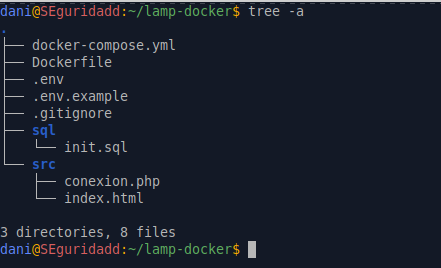


En el .env están mis contraseñas, así que lo he metido en el .gitignore para no subirlo a Git. En su lugar subo el .env.example, que tiene las mismas variables pero sin mis contraseñas, para que quien lo descargue sepa qué tiene que poner.

---

## 3. Código de los archivos

### docker-compose.yml

```yaml
services:
  web:
    build: .
    ports:
      - "8080:80"
    volumes:
      - ./src:/var/www/html
    depends_on:
      - db
    networks:
      - lamp_net

  db:
    image: mariadb:11.4
    env_file: .env
    volumes:
      - db_data:/var/lib/mysql
      - ./sql/init.sql:/docker-entrypoint-initdb.d/init.sql
    networks:
      - lamp_net

  adminer:
    image: adminer
    ports:
      - "8081:8080"
    depends_on:
      - db
    networks:
      - lamp_net

volumes:
  db_data:

networks:
  lamp_net:
```

### Dockerfile

```dockerfile
FROM php:8.3-apache
RUN docker-php-ext-install mysqli pdo_mysql
```

### .env.example

```
MYSQL_ROOT_PASSWORD=cambiar_root
MYSQL_DATABASE=alumnos_db
MYSQL_USER=alumno_iaw
MYSQL_PASSWORD=cambiar_password
```

### .gitignore

```
.env
src/report.html
```

### sql/init.sql

```sql
SET NAMES utf8mb4;

CREATE TABLE alumnos (
  id INT AUTO_INCREMENT PRIMARY KEY,
  nombre VARCHAR(100),
  edad INT
);

INSERT INTO alumnos (nombre, edad) VALUES
  ('Laura Martí', 20),
  ('Pau Ferrer', 22),
  ('Marta Soler', 19);
```

### src/index.html

```html
<!DOCTYPE html>
<html lang="es">
<head><meta charset="UTF-8"><title>LAMP con Docker</title></head>
<body>
  <h1>Dani Pérez</h1>
  <p>Implantación de Aplicaciones Web - 2º ASIR</p>
  <p><a href="conexion.php">Prueba de conexión</a></p>
</body>
</html>
```

### src/conexion.php

He aprovechado la plantilla de la práctica 1. He cambiado localhost por db y he añadido el INSERT.

```php
<?php
$servidor = "db";
$usuario = "alumno_iaw";
$password = "Iaw_Docker_2026";
$basededatos = "alumnos_db";

$conexion = mysqli_connect($servidor, $usuario, $password, $basededatos);

if (!$conexion) {
    die("Error al conectar con la base de datos: " . mysqli_connect_error());
}

mysqli_set_charset($conexion, "utf8mb4");

$insertar = "INSERT INTO alumnos (nombre, edad) VALUES ('Alumno desde PHP', 21)";

if (mysqli_query($conexion, $insertar)) {
    echo "<p>Registro insertado con id " . mysqli_insert_id($conexion) . "</p>";
} else {
    echo "<p>Error al insertar: " . mysqli_error($conexion) . "</p>";
}

$resultado = mysqli_query($conexion, "SELECT id, nombre, edad FROM alumnos");

echo "<h2>Listado de Alumnos (Docker)</h2>";
echo "<table border='1' cellpadding='5' cellspacing='0'>";
echo "<tr><th>ID</th><th>Nombre</th><th>Edad</th></tr>";

while ($fila = mysqli_fetch_assoc($resultado)) {
    echo "<tr>";
    echo "<td>" . htmlspecialchars($fila['id']) . "</td>";
    echo "<td>" . htmlspecialchars($fila['nombre']) . "</td>";
    echo "<td>" . htmlspecialchars($fila['edad']) . "</td>";
    echo "</tr>";
}

echo "</table>";

mysqli_close($conexion);
?>
```

---

## 4. Cómo funciona

### Los servicios

Cada servicio del compose es un contenedor. Los nombres que les he puesto (web, db y adminer) también sirven para que los contenedores se encuentren entre ellos dentro de la red, como si fueran nombres de máquina.

### La imagen de web

Para db y adminer cojo las imágenes de Docker Hub tal cual. Para web no me servía, porque la imagen de PHP con Apache no trae los conectores de MySQL. Por eso hice un Dockerfile: parto de php:8.3-apache y con docker-php-ext-install instalo mysqli y pdo_mysql. En el compose pongo build: . para que construya la imagen con ese Dockerfile.

### Los puertos

Se ponen como puerto de mi máquina : puerto del contenedor. Apache dentro escucha en el 80, pero lo saco por el 8080 para que no choque con otro servidor web. Adminer escucha en el 8080 dentro de su contenedor, así que lo saco por el 8081.

A db no le he puesto puertos a propósito. Así la base de datos solo se puede usar desde dentro de la red de Docker y nadie puede conectarse a ella desde fuera. En el docker compose ps se ve la diferencia: db sale con 3306/tcp a secas, mientras que los otros tienen delante 0.0.0.0, que significa que están publicados.

### La red

Los tres servicios están en la red lamp_net. Docker tiene un DNS dentro de la red que convierte el nombre de cada servicio en la IP de su contenedor. Por eso en el PHP pongo db como servidor y no localhost. Al principio no lo entendía, porque en la práctica 1 todo estaba en la misma máquina y localhost funcionaba. Aquí, para el contenedor web, localhost es él mismo, y ahí dentro no hay ninguna base de datos.

### Los volúmenes

He usado dos tipos:

- **./src:/var/www/html** Une mi carpeta src con la carpeta web del contenedor, así que si cambio un archivo lo veo al momento en el navegador sin tener que reiniciar nada.
- **db_data:/var/lib/mysql** Ahí guarda MariaDB los datos, y como están fuera del contenedor no se pierden aunque lo borre. Solo se borra si hago docker compose down -v.

### El .env

Con env_file le paso al contenedor db las variables del .env. Así no tengo ninguna contraseña en el docker-compose.yml. MariaDB usa esas variables la primera vez que arranca para crear el root, la base de datos alumnos_db y el usuario alumno_iaw. Es lo que en la práctica 1 hice a mano con CREATE USER y GRANT.

### depends_on

Sirve para que web y adminer arranquen después de db. Ojo, que solo espera a que arranque el contenedor, no a que MariaDB esté lista. A mí no me ha dado problemas porque PHP no se conecta al arrancar, sino cuando abro la página.

### El entrypoint y /docker-entrypoint-initdb.d/

Esto es lo que más me ha costado. La imagen de MariaDB, al arrancar, ejecuta un script que se llama docker-entrypoint.sh (se ve en la columna COMMAND del docker compose ps). Lo que hace es:

1. Mirar si /var/lib/mysql está vacío.
2. Si está vacío es el primer arranque, así que prepara MariaDB y crea el root, la base de datos y el usuario con las variables del .env.
3. Después ejecuta por orden alfabético los archivos .sql, .sql.gz o .sh que haya en /docker-entrypoint-initdb.d/. Los .sql los ejecuta dentro de la base de datos de MYSQL_DATABASE, por eso en mi init.sql no hace falta poner USE alumnos_db.
4. Si /var/lib/mysql ya tiene datos, se salta todo esto y arranca normal.

---

## 5. Despliegue

Para levantarlo todo:

```bash
sudo docker compose up -d --build
```

Como era la primera vez, descargó las imágenes de MariaDB y Adminer:

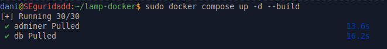

Luego construyó la imagen de web con mi Dockerfile y creó la red, el volumen y los contenedores:

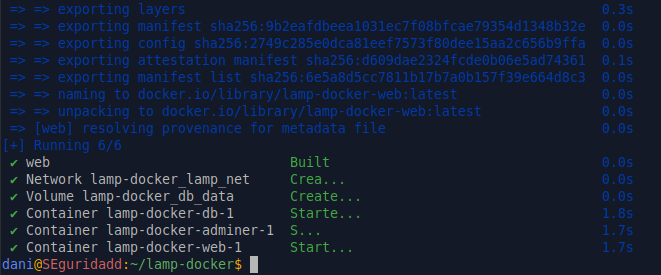

Compruebo que están los tres funcionando:

```bash
sudo docker compose ps
```

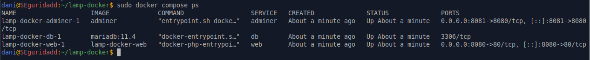

---

## 6. Acceso a los servicios

La página de inicio en http://192.168.3.170:8080:

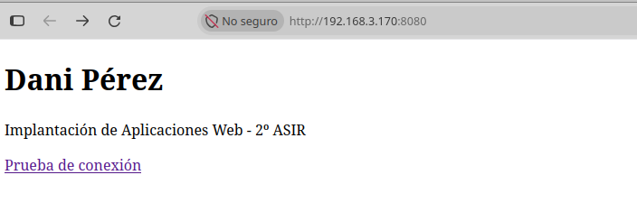

Adminer en http://192.168.3.170:8081. Como servidor pongo db, igual que en el PHP, porque Adminer también está dentro de la red:

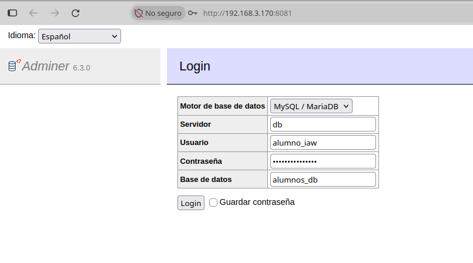

---

## 7. Prueba de conexión PHP - BD

En http://192.168.3.170:8080/conexion.php el script se conecta a db, inserta un registro y saca la tabla:

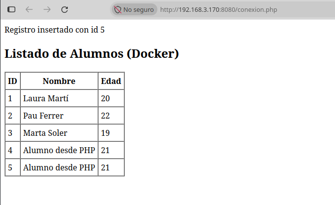

Salen varios Alumno desde PHP porque el INSERT está dentro del script y cada vez que recargo la página mete uno nuevo.


Los registros del script también se ven en Adminer:

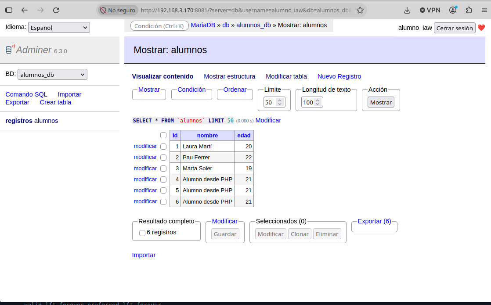

Esta captura la hice después de la prueba de persistencia, por eso ya sale también el 6.

---

## 8. Prueba de persistencia

Antes de parar tenía 5 registros:

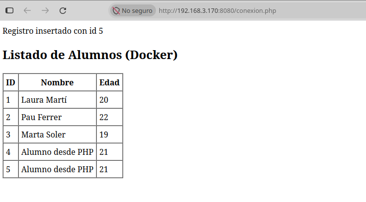

Paro todo y lo vuelvo a levantar:

```bash
sudo docker compose down
sudo docker compose up -d
```

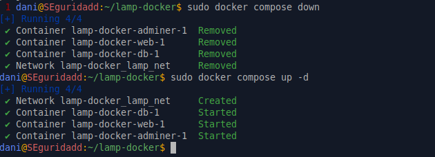

Con el down se borran los contenedores y la red, pero el volumen sigue estando:

```bash
sudo docker volume ls
```


Al recargar conexion.php siguen del 1 al 5 y aparece el 6. Si los datos se hubieran perdido, el contador habría vuelto a empezar. También se ve que el init.sql no se ha ejecutado otra vez, porque si no habría dado error al crear una tabla que ya existe.

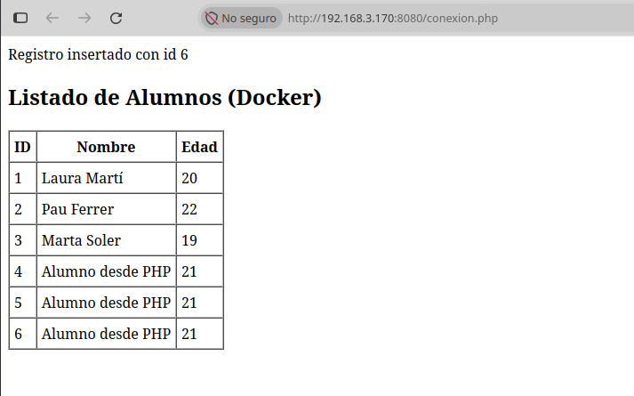

---

## 9. Bola extra: GoAccess

Elegí GoAccess porque ya lo usé en la práctica 1. La idea es tener otro contenedor que lea el log de Apache y saque un informe que se actualice solo.

### El problema del log

Me encontré con que en la imagen de PHP el access.log no es un archivo de verdad, sino un enlace a la salida de Docker. GoAccess necesita un archivo real, así que en el Dockerfile borro ese enlace y Apache crea el archivo al arrancar:

```dockerfile
FROM php:8.3-apache
RUN docker-php-ext-install mysqli pdo_mysql
RUN rm -f /var/log/apache2/access.log
```

### docker-compose.yml final

```yaml
services:
  web:
    build: .
    ports:
      - "8080:80"
    volumes:
      - ./src:/var/www/html
      - apache_logs:/var/log/apache2
    depends_on:
      - db
    networks:
      - lamp_net

  db:
    image: mariadb:11.4
    env_file: .env
    volumes:
      - db_data:/var/lib/mysql
      - ./sql/init.sql:/docker-entrypoint-initdb.d/init.sql
    networks:
      - lamp_net

  adminer:
    image: adminer
    ports:
      - "8081:8080"
    depends_on:
      - db
    networks:
      - lamp_net

  goaccess:
    image: allinurl/goaccess
    volumes:
      - apache_logs:/var/log/apache2:ro
      - ./src:/srv/report
    command: /var/log/apache2/access.log --log-format=COMBINED -o /srv/report/report.html --real-time-html
    ports:
      - "7890:7890"
    depends_on:
      - web
    restart: unless-stopped
    networks:
      - lamp_net

volumes:
  db_data:
  apache_logs:

networks:
  lamp_net:
```

### Qué he añadido

He creado el volumen apache_logs y lo he montado en los dos contenedores: web escribe ahí el log y goaccess lo lee. En goaccess le he puesto :ro para que sea solo lectura, porque no tiene que tocar el log.

GoAccess guarda el report.html en mi carpeta src, que es la que sirve Apache, así que lo veo en http://192.168.3.170:8080/report.html sin montar nada más.

En command van las mismas opciones que usé en la práctica 1: el log, el formato COMBINED, el archivo de salida y --real-time-html.

El puerto 7890 hay que abrirlo porque el informe en tiempo real y va por ahí. Sin él, el informe se ve pero no cambia.

Y el restart: unless-stopped lo puse por si GoAccess arranca antes de que exista el log. En ese caso fallaría, pero Docker lo vuelve a lanzar solo.

### Despliegue

```bash
sudo docker compose up -d --build
sudo docker compose ps
```

Descargó la imagen de GoAccess, reconstruyó web con el Dockerfile nuevo y creó el volumen de logs. db y adminer no cambiaron y siguieron funcionando, así que la base de datos no se tocó:

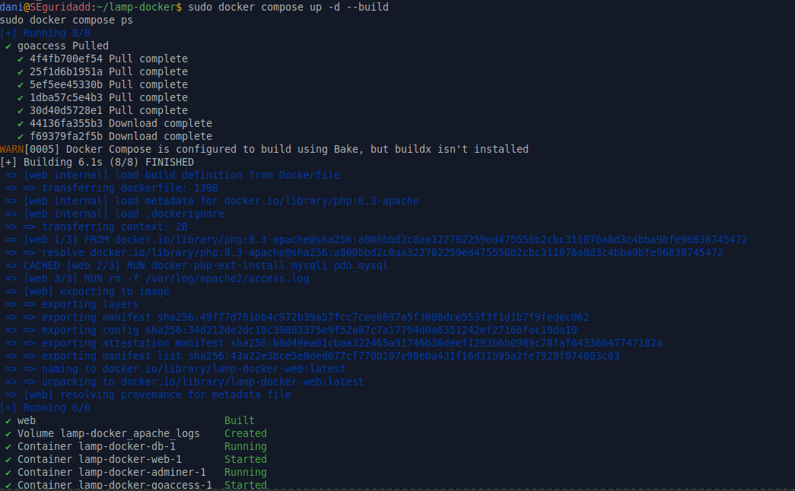

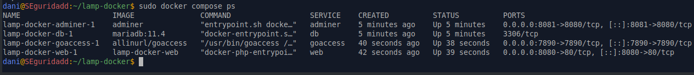

### Prueba

La primera vez que abrí el informe solo había 1 petición, la del propio report.html, porque el volumen de logs era nuevo:

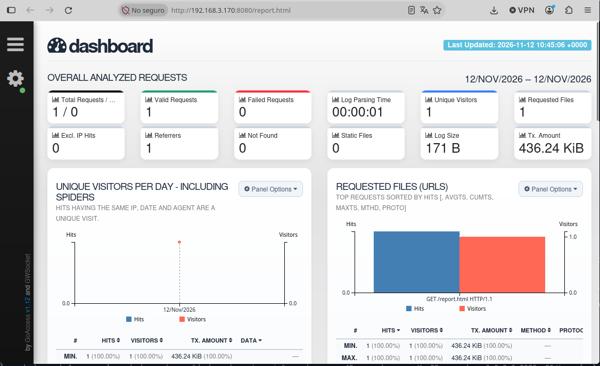

Abrí conexion.php en otra pestaña y, sin recargar, el informe se actualizó solo: subió a 3 peticiones, salió conexion.php en la lista y la hora de Last Updated pasó de 10:45:06 a 10:45:34.

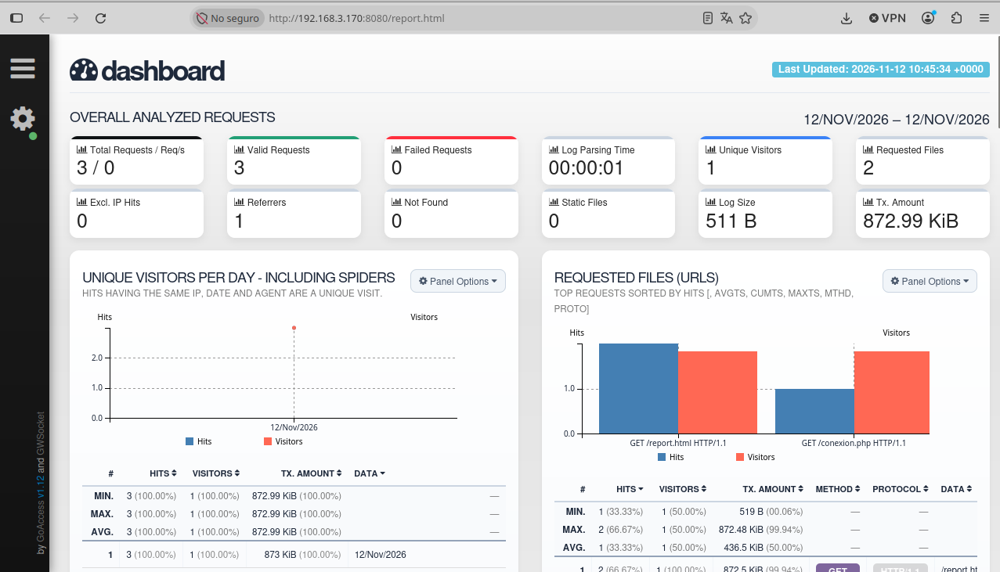

---
