# UD02 - Tarea 1: Pila LAMP en Ubuntu sobre Proxmox
## Dani Perez
### ASIR 2

---


## Paso 1: Servidor web Apache

Instalación y comprobación del servicio:

```bash
apt update && apt install -y apache2
systemctl status apache2
systemctl is-enabled apache2
```

El servicio aparece como `active (running)` y `enabled`, así que arrancará solo cada vez que se inicie la máquina. Al entrar a `http://192.168.3.242` sale la página por defecto de Apache en Ubuntu.

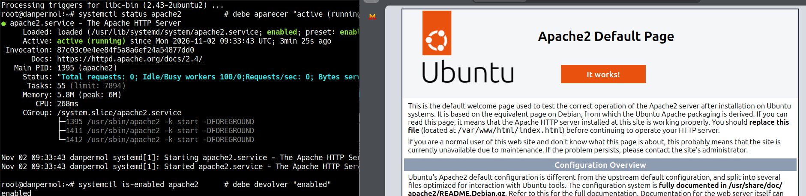

Luego he sustituido `/var/www/html/index.html` por una página propia:

```bash
nano /var/www/html/index.html
```

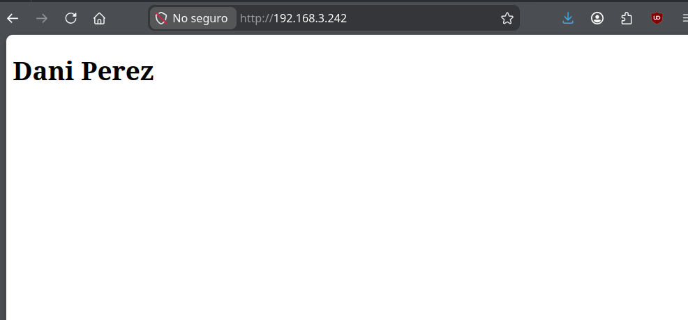

---

## Paso 2: Base de datos MariaDB

```bash
apt install -y mariadb-server
mariadb
```

Sentencias SQL que he ejecutado:

```sql
CREATE DATABASE alumnos_db;

CREATE USER 'alumno_iaw'@'localhost' IDENTIFIED BY 'password_segura';
GRANT ALL PRIVILEGES ON alumnos_db.* TO 'alumno_iaw'@'localhost';
FLUSH PRIVILEGES;

USE alumnos_db;

CREATE TABLE alumnos (
  id INT AUTO_INCREMENT PRIMARY KEY,
  nombre VARCHAR(100) NOT NULL,
  edad INT
);

INSERT INTO alumnos (nombre, edad) VALUES
  ('Laura Mart', 20),
  ('Pau Ferrer', 22),
  ('Marta Soler', 19);

SELECT * FROM alumnos;
```

He creado un usuario específico (`alumno_iaw`) con permisos solo sobre `alumnos_db` para no usar `root` desde la aplicación web.

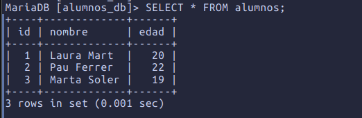


---

## Paso 3: PHP y conexión con la base de datos

```bash
apt install -y php libapache2-mod-php php-mysql
systemctl restart apache2
echo "<?php phpinfo(); ?>" > /var/www/html/info.php
```

En `http://192.168.3.242/info.php` se ve que está instalado PHP y que funciona a través de Apache.

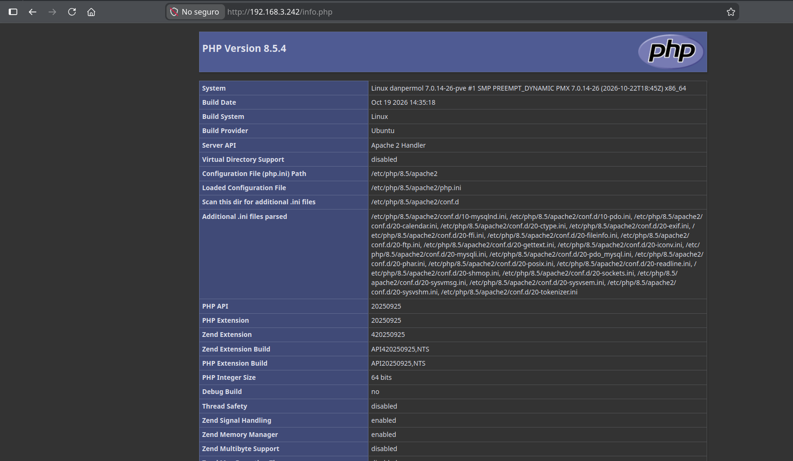

Después he creado `/var/www/html/consulta.php` con la plantilla del anexo, usando el usuario `alumno_iaw` del paso anterior. Al abrirlo en el navegador se genera la tabla con los datos de la base de datos:

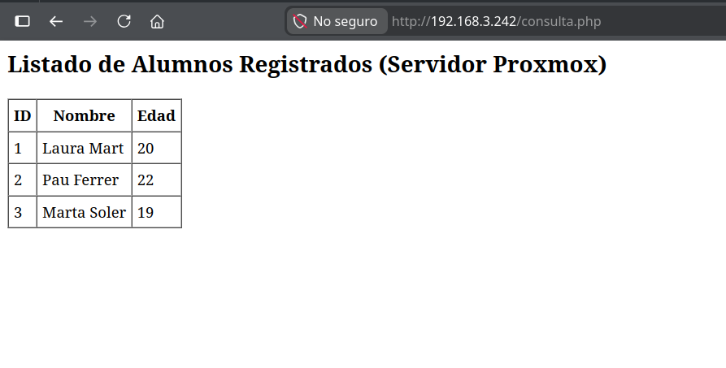

---

## Paso 4: Gestor web Adminer

He elegido Adminer porque es un único archivo PHP y no hace falta configurar nada en Apache:

```bash
wget -O /var/www/html/adminer.php https://www.adminer.org/latest.php
```

Me he autenticado con el usuario `alumno_iaw` sobre la base de datos `alumnos_db`:

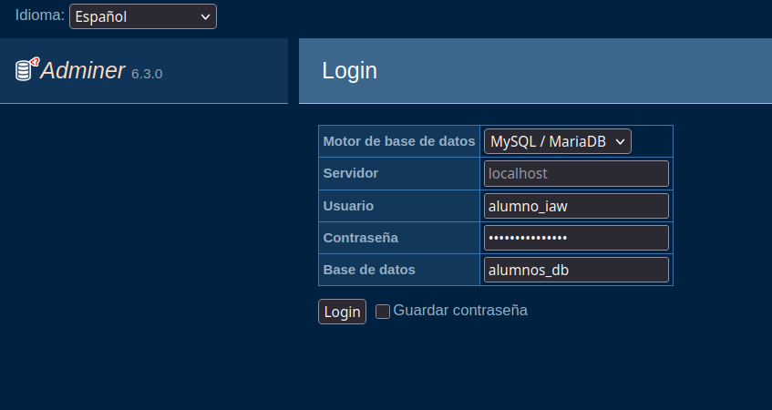

Sesión iniciada dentro de `alumnos_db`.

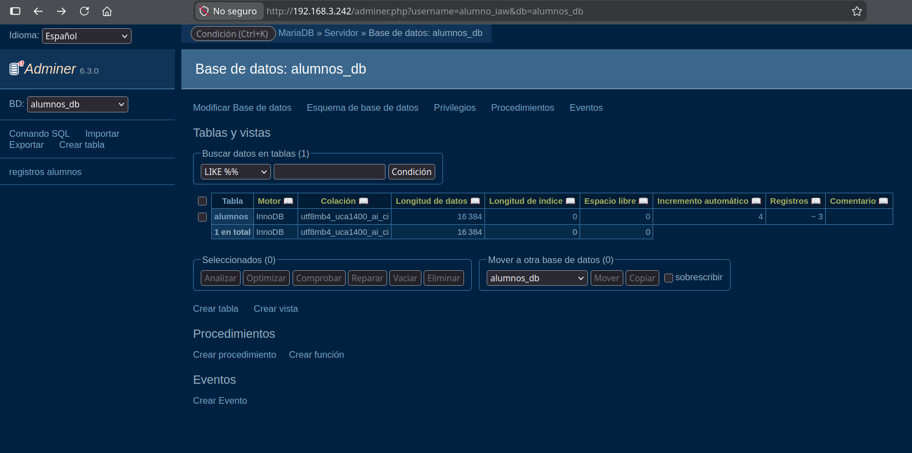

Aqui esta el contenido de la tabla con nuestros usuarios.

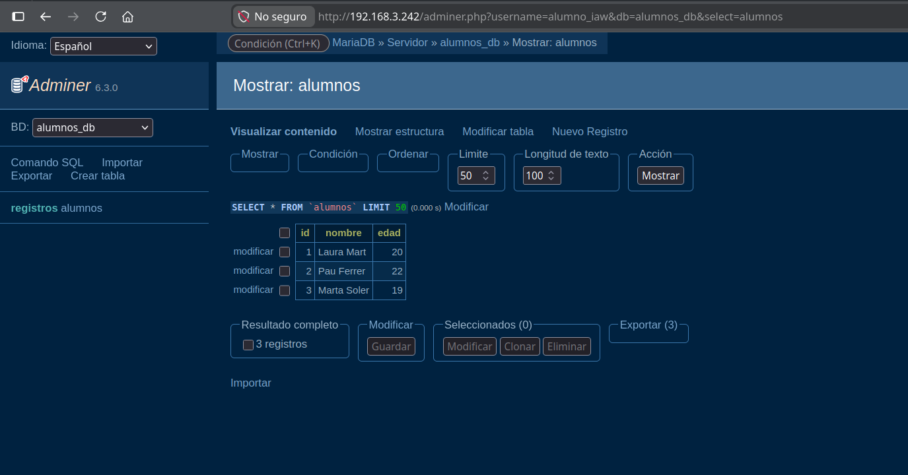


---

## Paso 5: Análisis de logs con GoAccess

```bash
apt install -y goaccess
goaccess /var/log/apache2/access.log --log-format=COMBINED
```

La opción `--log-format=COMBINED` indica el formato de log que usa Apache en Ubuntu por defecto; si no se pone, GoAccess pregunta el formato al arrancar.

En el panel de terminal se ven 23 peticiones y las URLs más pedidas: `/`, `adminer.php`, `info.php` y `consulta.php`.

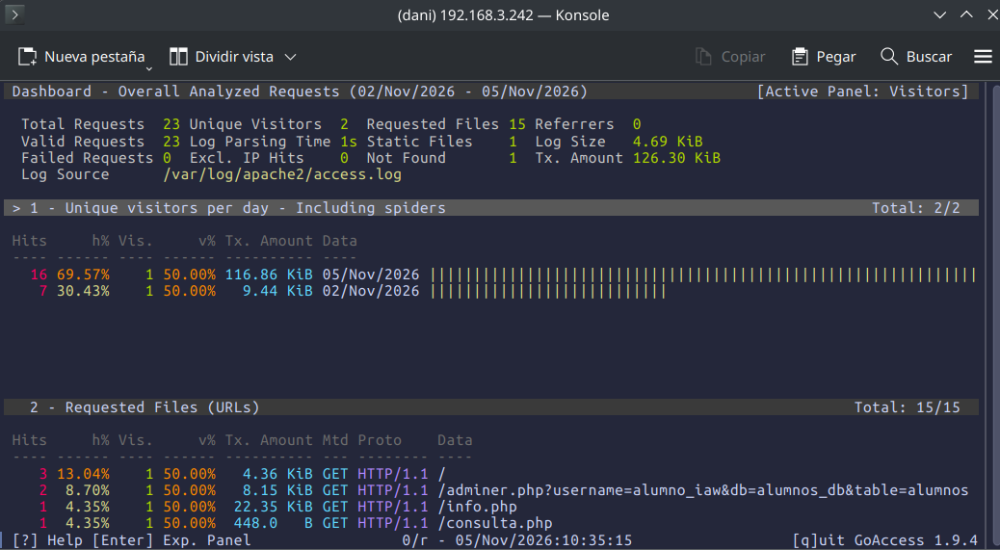

Para el informe web en tiempo real:

```bash
goaccess /var/log/apache2/access.log --log-format=COMBINED \
  -o /var/www/html/reporte.html --real-time-html --daemonize
```

- `-o` guarda el informe en HTML dentro de la raíz web.
- `--real-time-html` mantiene el informe actualizado mediante un WebSocket.
- `--daemonize` lo deja en segundo plano.

Primera captura del informe con **26 peticiones**:

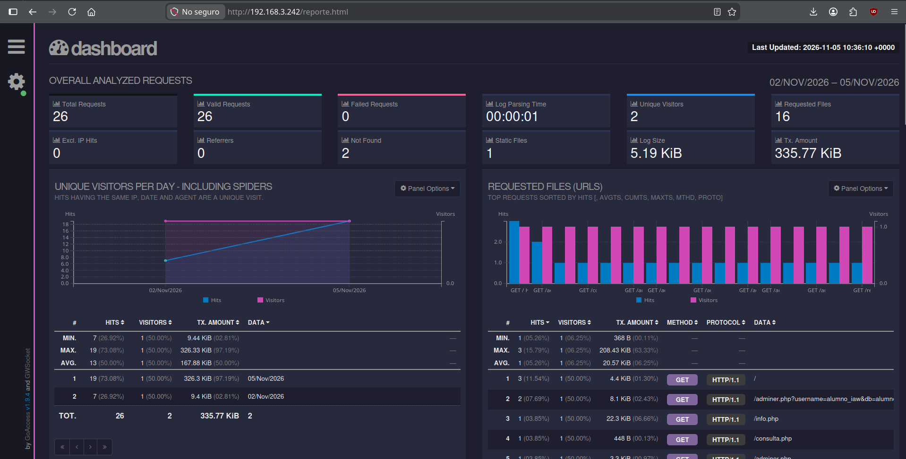

Después he navegado por `info.php`, `consulta.php` y Adminer, y sin recargar la página el informe se ha actualizado solo y ya marca **32 peticiones** y aparecen peticiones nuevas:

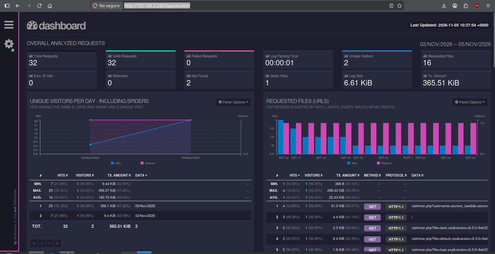


